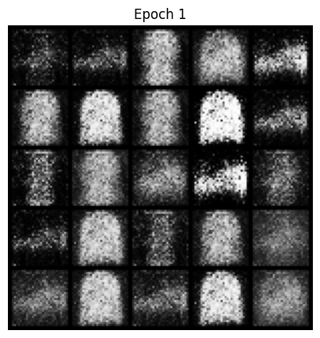
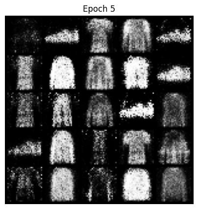
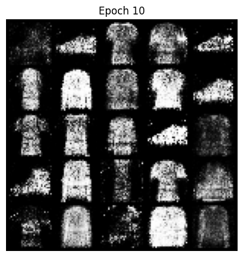
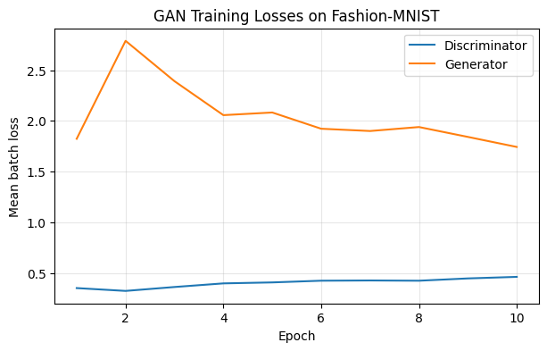

# ETMMGA304 — Lab 2: Image Synthesis Using GANs (Fashion-MNIST)

PyTorch implementation of a **Generative Adversarial Network (MLP GAN, $z=64$)** trained on Fashion-MNIST for **ETMMGA304: Generative AI and Its Applications** (MCA — AI & ML, K.R. Mangalam University).

## Repository Contents
- `Lab2_GAN_FashionMNIST.ipynb` — Complete executed Google Colab (T4 GPU) notebook (`SEED = 42`).
- `lab_outputs/` — Saved fixed-latent sample grids (`gan_epoch_01.png`, `gan_epoch_05.png`, `gan_epoch_10.png`) and loss curve (`gan_losses.png`).

## Key Experimental Results (`SEED = 42`, 10 Epochs)
- **Generator Loss (`G_loss`):** Decreased from `2.789` (Epoch 2 peak) to `1.743`.
- **Discriminator Loss (`D_loss`):** Rose from `0.350` → `0.461` as generator quality improved.
- **Visual Progression:** Recognizable clothing samples improved from `3/25` (Epoch 1) → `15/25` (Epoch 5) → `19/25` (Epoch 10).

## Visual Outputs

| Epoch 1 | Epoch 5 | Epoch 10 | Training Losses |
| :---: | :---: | :---: | :---: |
|  |  |  |  |

## How to Run
1. Upload `Lab2_GAN_FashionMNIST.ipynb` to [Google Colab](https://colab.research.google.com/).
2. Select **Runtime → Change runtime type → T4 GPU** and run all cells sequentially.

## Author
- **Ashish Raj** — MCA (AI & ML), K.R. Mangalam University | [@AshishRaj5191](https://github.com/AshishRaj5191)
